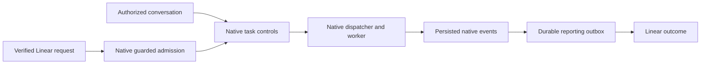

# Linear reports native Hermes work

## User outcome and current limits

The target experience is documented in the [ongoing-work job](../reference/jobs/entrust-ongoing-work.md).
Assigning a configured Hermes agent in Linear or asking one in Telegram, Slack, or Desktop
to work on or take over an issue should lead to the same durable native execution. The agent
first reads the issue and inspects actual work, then continues it, arranges an authorized
handoff, or starts only the remaining work. The user should not manage tracking links,
activation steps, or checkpoint relays between agents.

**This is not yet the complete implemented experience.** The
[UX outcome review and revised sequence](../reference/rfcs/durable-work-execution.md#ux-outcome-review-2026-10-26)
identify the original profile/home, admission, and takeover gaps. Caller identity resolution,
guarded initial admission, and explicit reporting-link replacement address parts of that
review. Actual handoff and client journeys still need their separate acceptance evidence.
The mechanisms below describe implementation and compatibility limits, not passed live UAT.

Ordinary conversation, short commands and status questions require no Linear issue. When
work needs durability, use one native task and optionally link its human outcome with
`linear track`. An authenticated conversation can discuss or follow that task from another
surface without moving its executor or returning to an old chat.

| Before | After |
| --- | --- |
| Chat claim selected the conversation allowed to work or edit an issue. | Native identity and task scope authorize work; issue edits do not require a task link. |
| Transfer and resume phrases carried execution meaning. | Native task actions carry structured state; natural language is interpreted in the authenticated conversation. |
| Restart prose injected another chat turn. | Persisted native history feeds the reporting outbox; notifications grant no execution. |
| Plugin retirement inspected and controlled worker processes. | Native worker claims, run IDs, recovery, Stop and terminal reaping remain authoritative. |
| Separate chat and task execution paths could disagree. | A binding records native profile, board and task for reporting, with no competing executor lock. |

## Upstream boundary and reduced automation

The plugin targets the public API at official Hermes
`ff294849385e433dd40a993b4f07673abb95c6f5`. The aligned fork release is
`5282b788113aef959925397d05252d883cd7c4be`; the plugin does not require the fork's
invocation-context or profile-service APIs, approval helpers or lifecycle extensions.

On a native host with task-event guards and resume receipts, validated Linear assignments create tasks blocked
and activate only against their original creation token. A newer Stop invalidates activation;
delivery retries retain the same token. A crash after linking can finish admission through
the existing recovery path. No second execution controller or manual activation is required.

Older hosts without native task-event guards retain parked assignment behavior and explain
the missing capability. Existing parked or legacy records are not automatically adopted.
Native creation retry lookup remains non-atomic; ambiguous creation is reconciled, not repeated.

Running cancellation is relayed only with verified ordering and a concrete native run ID.
Cancellation of a queued or otherwise unverified run remains a visible reconciliation request
for native controls; it is not an effective Stop. A blocked state or an acknowledged request
does not prove external processes or effects ended. Native process observation and terminal
reaping remain necessary. The plugin never kills a PID or clears revoked authority.

Native guarded Stop also covers queued work when source ordering can be verified. Conflicting
or unverifiable later native controls remain a scoped reconciliation case. Existing native
task creation and active linked follow-ups retain their native behavior.

## Delivery and migration

The existing metadata/outbox store records native delivery attempts before a call. Duplicate
ingress coalesces to one attempted create or comment. A lost response is reconciled against
actual native state; a missing or ambiguous result stays visible without blind replay.
The reporting cursor and its remote intents commit together. Native notification cursors are
not consumed to stand in for that commit.

An existing task can be linked on the native caller's board or an explicitly selected existing
board. Native scope and worker pins still apply. Its recorded board routes later follow-ups
and reporting; the configured Linear creation board does not require moving or duplicating
ordinary or project work. Missing and archived boards are not created or reopened by tracking.

Human issue edits, closure and reassignment are inspected again at remote mutation boundaries.
Status intents retain the source event time so delayed catch-up cannot overwrite a later
human decision. Reporting failures queue in the outbox without controlling native execution.

Legacy chat bindings, admissions, transfers, retirement records, pending Stop requests and
unknown remote effects stay inspectable. They are not automatically adopted, deleted or
replayed. Preserve their workspaces, checkpoints, PRs and original effect history. The operator
view names required reconciliation. Unlinked issue operations retain app/workspace/specialist
authorization independently of those old execution claims.

Retained deliveries receive a separate hold reason before delivery or receipt consumption.
Holding preserves their original payload, state, attempt count and deadline, including
orphaned deliveries whose work row is gone. Verified external release does not delete stopped
work. A new authorized comment can deliver independently; replacing a description still waits
for any uncertain earlier description effect to be reconciled.

## Evidence boundaries

The native scenario suite exercises upstream task creation, claiming, lifecycle and comment
consumption; the registered tool and private socket are exercised with actual upstream session
producers, including a separate API process. Cases cover concurrent and duplicate requests,
lost replies, parked creation during Stop, stale run rejection, reporting restart, human edits,
outages and specialist assessments. The source is also exercised against the pre-release core
to establish bundle staging compatibility.

Retired tests asserted chat claims, transfer ceremonies, restart injection and plugin process
retirement. Their replacements assert preserved legacy data, no automatic adoption or replay,
native bindings, immutable delivery attempts and ordinary unlinked operations. Credential,
workspace, requester, actor, content readback, project batching and uncertain-effect tests
remain in the suite.

These tests do not prove authenticated Desktop, Telegram or Slack client round-trips or the
end of background external effects after Stop. Those require separate deployed acceptance.
Passing tests, merged source, published artifacts, deployment and live UX are distinct results.
